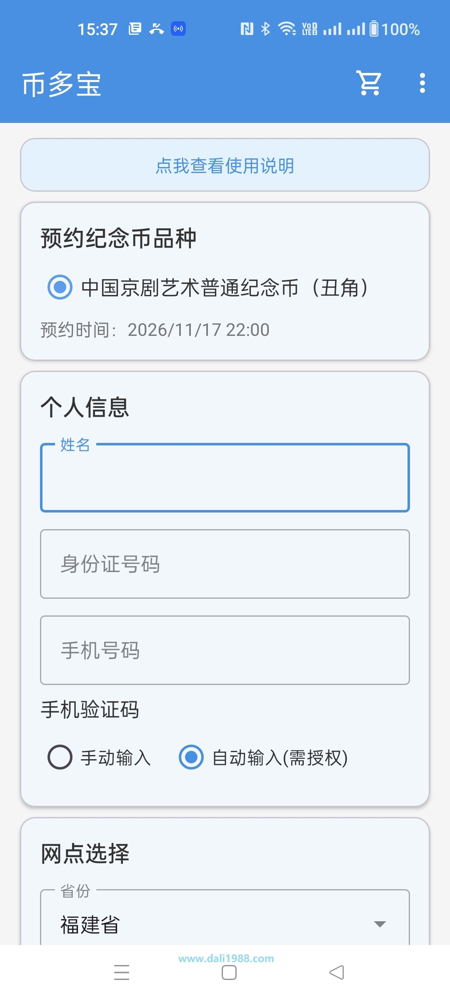
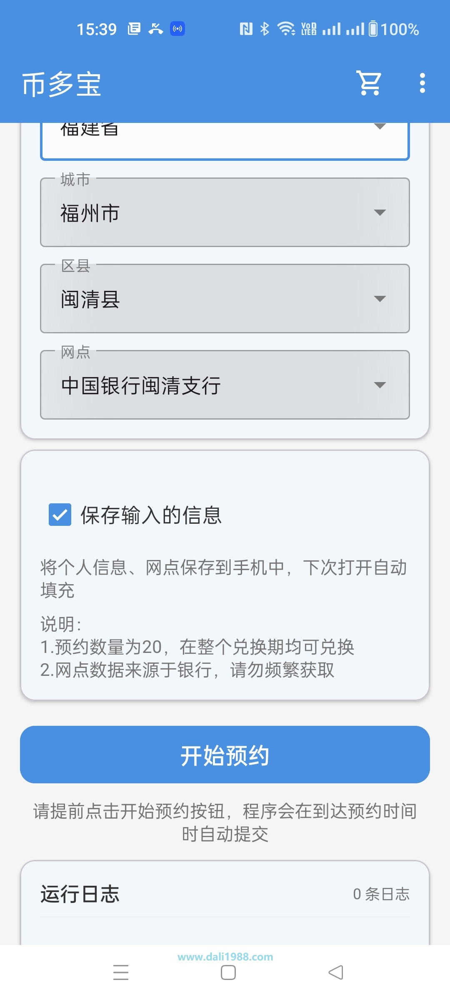
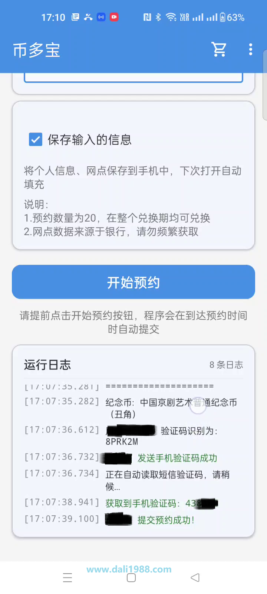

# 币多宝 · 中国银行纪念币预约助手

> 一款面向 Android 的中国银行纪念币预约工具：提前保存个人信息与银行网点，在预约时间到达后，自动完成验证码识别、短信验证码填入与预约提交。

  
  
  

  Android · 个人纪念币预约辅助 · 已在上次预约中完成实测

## 项目简介

用户可以在预约前录入并检查个人资料、预约品种和银行网点；到达预约时间后，应用根据预设信息执行预约流程，并在界面中输出运行日志，方便确认每一步的执行结果。

## 功能特性

- **个人信息预录入**：提前填写姓名、身份证号码、手机号码等预约所需信息。
- **网点信息配置**：按省份、城市、区县选择预约网点，减少临场查找和输入。
- **图片验证码识别**：自动识别预约页面中的图片验证码。
- **手机验证码辅助**：在获得必要系统授权后，自动读取并填入本人手机收到的短信验证码；也支持手动输入。
- **定时执行预约**：提前点击“开始预约”，到达预设预约时间后自动继续流程。
- **运行日志**：显示验证码识别、短信发送、短信读取和提交结果等关键节点。
- **信息本地复用**：保存个人信息和网点信息后，下次打开可自动填充，减少重复操作。

## 使用流程

1. 在 Android 手机上安装中国银行纪念币预约 APK。
2. 打开应用，录入并核对个人信息。
3. 选择省份、城市、区县和具体预约网点。
4. 根据需要选择“手动输入”或“自动输入”手机验证码。
5. 勾选保存信息，确认预约时间与预约品种。
6. 提前点击“开始预约”，保持手机网络、短信接收和系统权限正常。
7. 预约结束后查看运行日志，并前往中国银行官方渠道确认最终预约状态。

## 实测表现

应用已在上一次纪念币预约中验证成功：

| 指标 | 实测结果 |
| --- | --- |
| 预约结果 | 成功提交预约 |
| 总耗时 | 约 4 秒 |
| 短信验证码等待 | 约 2 秒，已包含在总耗时内 |
| 流程 | 图片验证码识别 → 短信验证码获取 → 提交 |

## 截图预览

### 1. 个人信息与预约品种

提前填写个人资料、选择预约品种，并配置手机验证码的输入方式。

### 2. 网点选择与开始预约

选择省份、城市、区县和具体网点。确认信息后，提前点击“开始预约”，应用会在预约时间到达后继续执行。

### 3. 预约成功日志

运行日志会记录关键步骤，示例中包含图片验证码识别、短信验证码读取和“提交预约成功”等状态。

